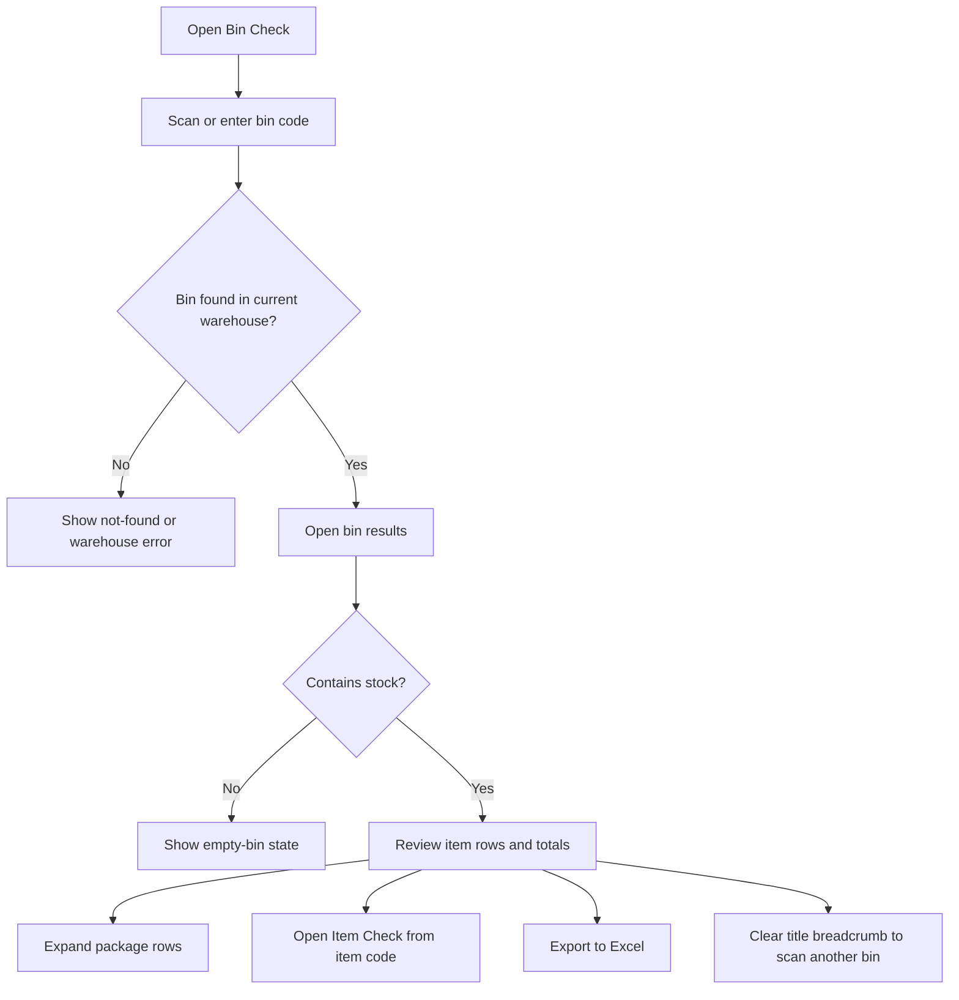

Bin Check shows the live contents of one bin-managed warehouse location. Use it to confirm what is physically in a rack, shelf, staging area, or system bin before counting, picking, transferring, or investigating stock discrepancies.

## Accessing the Page

Route: `/binCheck`

Direct route with selected bin: `/binCheck/:binEntry/:binCode`

Navigation: Dashboard -> Bin Check

Bin Check is only available when the signed-in user is connected to a bin-managed warehouse. If the user is not connected to a bin-managed warehouse, the page shows the alert **You're not connected to a bin managed warehouse.**

## When to Use

Use Bin Check when you need to:

- Verify the stock currently assigned to a bin location.
- Review which items and packages are stored in a bin before moving stock.
- Open an item directly from a bin result row for deeper Item Check details.
- Confirm whether a bin is empty.
- Export the visible bin content for offline review.

## Workflow

## Scan a Bin

The default page focuses the **Bin Location** scanner field. Enter a bin code manually or scan a bin barcode, then select **Accept**.

After a value is entered, **Accept** becomes available. The scanner accepts up to 255 characters.

## Fields

| Field | Required | Type | Description | Default | Validation |
|-------|----------|------|-------------|---------|------------|
| **Bin Location** | Yes | Text / scanner input | Bin code used to identify the warehouse location. | Empty | **Accept** is disabled until a non-empty value is entered. The code must resolve to a bin in the current warehouse. Maximum 255 characters. |

## Results / Details

When the bin is found, the page changes to the result view. The title breadcrumb shows the selected bin code, and the export action appears in the top bar.

### Item Rows

Each row represents one item stored in the selected bin.

| Display | Description |
|---------|-------------|
| **Item code** | Blue link that opens Item Check for that item. |
| **Item name** | Item description from the warehouse item data. |
| **Quantity text** | Human-readable stock breakdown, such as boxes, dozens, and units. |
| **Unit badges** | Small `P`, `D`, and `U` boxes summarize the row quantity by unit type when unit selection is enabled. `P` means packs/boxes, `D` means dozens, and `U` means loose units. Colored boxes mean that unit type has a quantity; gray boxes mean zero for that unit type. |
| **Chevron** | Appears only when package details are available for the item. Select the row to expand or collapse details. |

### Expanded Package Rows

Rows with package content can be expanded. The expanded area shows pack, dozen, and unit counts, the package barcode list, package quantities, and the total base-unit quantity.

### Unit Indicator Boxes

The small boxes on the right side of each stock row are quick quantity indicators. They help the operator see whether the row contains full packs, full dozens, or remaining loose units without opening the row.

| Box | Meaning | Color Behavior |
|-----|---------|----------------|
| **P** | Pack or box quantity calculated from the item's purchase pack settings. | Colored when one or more full packs exist; gray when there are no full packs. |
| **D** | Dozen quantity calculated after full packs are removed. | Colored when one or more dozens exist; gray when there are no dozens. |
| **U** | Loose unit remainder after packs and dozens are calculated. | Colored when loose units remain; gray when there are no loose units. |

If base units are disabled for the user, the **U** box may not be shown. The labels can also follow the user's unit settings, but the default English abbreviations are `P`, `D`, and `U`.

### Totals Summary

The bottom summary cards calculate totals for the selected bin.

| Summary | Description |
|---------|-------------|
| **Total Items** | Number of distinct item rows returned for the bin. |
| **Total Boxes** | Sum of full package/box quantities calculated from item quantity, purchase pack units, and units per pack. If unit selection is disabled, this card displays **Total Items** instead. |
| **Mixed Boxes** | Number of unique package barcodes found in the bin. This card appears only when package tracking is enabled. |

## Empty Bin

If the bin exists but has no stock, Bin Check shows **Bin is Empty** and **No content found for bin location**, followed by zero-value summary cards.

## Actions

| Action | Availability | Result |
|--------|--------------|--------|
| **Accept** | Available after entering a bin code. | Validates the bin and opens the result view. |
| **Select title / breadcrumb** | Available after results load. | Clears the current bin and returns to the scanner. |
| **Export** | Available after results load. | Downloads an Excel file with **Code**, **Description**, and quantity columns based on the user's unit settings. |
| **Select item code** | Available on each item row. | Opens Item Check for that item. |
| **Select expandable row** | Available when the row has package content. | Shows or hides package-level details. |

## Messages

| Message | When It Appears | What to Do |
|---------|-----------------|------------|
| **Bin Location {code} not found.** | The scanned or entered value does not match a known bin location. | Confirm the barcode/code and scan again. |
| **Bin not in warehouse** | The bin exists but is not assigned to the current warehouse context. | Switch to the correct warehouse or use a bin from the current warehouse. |
| **Bin is Empty** | The selected bin exists but has no item content. | Use another bin or confirm the physical location is expected to be empty. |
| **No content found for bin location** | Empty-bin detail message below the empty state title. | No action is required if the bin should be empty. |
| **You're not connected to a bin managed warehouse.** | The signed-in user has no bin-managed warehouse context. | Sign in with a warehouse user that has bin locations enabled. |

## Related Pages

- [Item Check](/docs/item-management/item-check)
- [Package Check](/docs/item-management/package-check)
