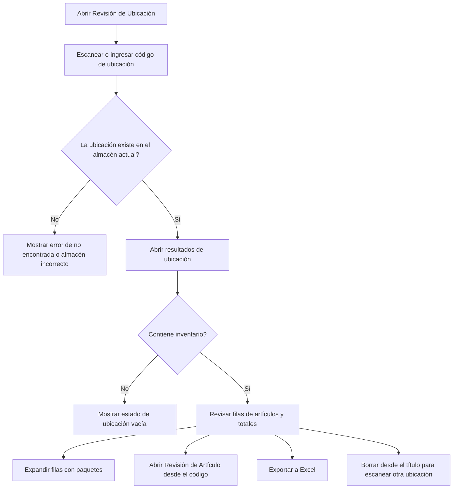

La Revisión de Ubicación muestra el contenido en vivo de una ubicación de almacén gestionada por ubicaciones. Úsela para confirmar qué hay físicamente en un rack, estante, área de staging o ubicación de sistema antes de contar, seleccionar, transferir o investigar diferencias de inventario.

## Acceso a la Página

Ruta: `/binCheck`

Ruta directa con ubicación seleccionada: `/binCheck/:binEntry/:binCode`

Navegación: Panel Principal -> Revision de Ubicación

Revisión de Ubicación solo está disponible cuando el usuario conectado pertenece a un almacén gestionado por ubicaciones. Si el usuario no está conectado a un almacén gestionado por ubicaciones, la página muestra la alerta **You're not connected to a bin managed warehouse.**

## Cuándo Usar

Use Revisión de Ubicación cuando necesite:

- Verificar el inventario actualmente asignado a una ubicación.
- Revisar qué artículos y paquetes están almacenados en una ubicación antes de mover inventario.
- Abrir un artículo directamente desde una fila de resultado para ver más detalles en Revisión de Artículo.
- Confirmar si una ubicación está vacía.
- Exportar el contenido visible de la ubicación para revisión fuera del sistema.

## Flujo de Trabajo

## Escanear una Ubicación

La página inicial enfoca el campo escáner **Ubicación**. Ingrese manualmente un código de ubicación o escanee un código de barras de ubicación, luego seleccione **Aceptar**.

Después de ingresar un valor, **Aceptar** queda disponible. El escáner acepta hasta 255 caracteres.

## Campos

| Campo | Requerido | Tipo | Descripción | Predeterminado | Validación |
|-------|-----------|------|-------------|----------------|------------|
| **Ubicación** | Sí | Texto / entrada de escáner | Código de ubicación usado para identificar la ubicación del almacén. | Vacío | **Aceptar** está deshabilitado hasta que se ingrese un valor no vacío. El código debe resolver a una ubicación del almacén actual. Máximo 255 caracteres. |

## Resultados / Detalles

Cuando se encuentra la ubicación, la página cambia a la vista de resultados. La ruta del título muestra el código de ubicación seleccionado y la acción de exportación aparece en la barra superior.

### Filas de Artículos

Cada fila representa un artículo almacenado en la ubicación seleccionada.

| Visualización | Descripción |
|---------------|-------------|
| **Código de artículo** | Enlace azul que abre Revisión de Artículo para ese artículo. |
| **Nombre de artículo** | Descripción del artículo desde los datos de inventario. |
| **Texto de cantidad** | Desglose legible del inventario, como cajas, docenas y unidades. |
| **Indicadores de unidad** | Pequeñas cajas `C`, `D` y `U` resumen la cantidad de la fila por tipo de unidad cuando la selección de unidades está activa. `C` significa cajas, `D` significa docenas y `U` significa unidades sueltas. Las cajas con color indican que ese tipo de unidad tiene cantidad; las cajas grises indican cero para ese tipo de unidad. |
| **Flecha** | Aparece solo cuando hay detalles de paquete disponibles para el artículo. Seleccione la fila para expandir o contraer detalles. |

### Filas de Paquete Expandidas

Las filas con contenido de paquete se pueden expandir. El área expandida muestra conteos de caja, docena y unidad, la lista de códigos de barras de paquete, cantidades por paquete y la cantidad total en unidades base.

### Cajas Indicadoras de Unidad

Las cajas pequeñas al lado derecho de cada fila de inventario son indicadores rápidos de cantidad. Ayudan al operario a ver si la fila contiene cajas completas, docenas completas o unidades sueltas restantes sin abrir la fila.

| Caja | Significado | Comportamiento de Color |
|------|-------------|-------------------------|
| **C** | Cantidad de caja o paquete calculada desde la configuración de empaque de compra del artículo. | Con color cuando existe una o más cajas completas; gris cuando no hay cajas completas. |
| **D** | Cantidad de docenas calculada después de separar las cajas completas. | Con color cuando existe una o más docenas; gris cuando no hay docenas. |
| **U** | Resto de unidades sueltas después de calcular cajas y docenas. | Con color cuando quedan unidades sueltas; gris cuando no hay unidades sueltas. |

Si las unidades base están deshabilitadas para el usuario, la caja **U** puede no mostrarse. Las etiquetas también pueden seguir la configuración de unidades del usuario, pero las abreviaturas predeterminadas en español son `C`, `D` y `U`.

### Resumen de Totales

Las tarjetas inferiores calculan totales para la ubicación seleccionada.

| Resumen | Descripción |
|---------|-------------|
| **Total Artículos** | Número de filas de artículos distintos devueltas para la ubicación. |
| **Total Paquetes** | Suma de cantidades completas de paquete/caja calculadas desde la cantidad del artículo, unidades de compra y unidades por paquete. Si la selección de unidades está desactivada, esta tarjeta muestra **Total Artículos** en su lugar. |
| **Paquetes Mixtos** | Número de códigos de barras de paquete únicos encontrados en la ubicación. Esta tarjeta aparece solo cuando el seguimiento de paquetes está habilitado. |

## Ubicación Vacía

Si la ubicación existe pero no tiene inventario, Revisión de Ubicación muestra **Ubicación Vacía** y **No se encontraron datos de ubicación**, seguido por tarjetas de resumen en cero.

## Acciones

| Acción | Disponibilidad | Resultado |
|--------|----------------|-----------|
| **Aceptar** | Disponible después de ingresar un código de ubicación. | Valida la ubicación y abre la vista de resultados. |
| **Seleccionar título / ruta** | Disponible después de cargar resultados. | Borra la ubicación actual y regresa al escáner. |
| **Exportar** | Disponible después de cargar resultados. | Descarga un archivo Excel con **Codigo**, **Descripción** y columnas de cantidad según la configuración de unidades del usuario. |
| **Seleccionar código de artículo** | Disponible en cada fila de artículo. | Abre Revisión de Artículo para ese artículo. |
| **Seleccionar fila expandible** | Disponible cuando la fila tiene contenido de paquete. | Muestra u oculta detalles a nivel de paquete. |

## Mensajes

| Mensaje | Cuándo Aparece | Qué Hacer |
|---------|----------------|----------|
| **Ubicación del contenedor {código} no encontrada.** | El valor escaneado o ingresado no coincide con una ubicación conocida. | Confirme el código/código de barras y escanee nuevamente. |
| **Ubicación no en almacén** | La ubicación existe pero no está asignada al almacén actual. | Cambie al almacén correcto o use una ubicación del almacén actual. |
| **Ubicación Vacía** | La ubicación seleccionada existe pero no tiene contenido de artículos. | Use otra ubicación o confirme que la ubicación física debe estar vacía. |
| **No se encontraron datos de ubicación** | Mensaje de detalle debajo del título de ubicación vacía. | No se requiere acción si la ubicación debe estar vacía. |
| **You're not connected to a bin managed warehouse.** | El usuario conectado no tiene contexto de almacén gestionado por ubicaciones. | Inicie sesión con un usuario de almacén que tenga ubicaciones habilitadas. |

## Páginas Relacionadas

- [Revisión de Artículo](/docs/item-management/item-check)
